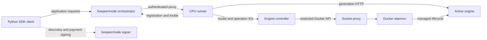

# Architecture

Runtime code lives in `src/video_runners/`. The real root `compose.prod.yml` and
`compose.dev.yml` files are the everyday entry points; supporting recipes,
Dockerfiles and templates live in `deploy/`. Compatibility aliases are removed.
See the [layout guide](docs/guides/repository-layout.md) for exact command/path mappings
and the [cleanup record](docs/plans/active/deployment-cleanup.md) for the completed
scope. Future validation is tracked in the [debt list](docs/plans/tech-debt.md).

## Runtime components

The signer is optional for free offchain testing. The Python `livepeer-gateway`
package is the application SDK; this architecture uses no separate traditional
gateway daemon. See the [node guide](docs/guides/node-deployment.md) for the two node roles.

| Source                                                                                     | Current responsibility                                                                                                                                                                                                    |
| ------------------------------------------------------------------------------------------ | ------------------------------------------------------------------------------------------------------------------------------------------------------------------------------------------------------------------------- |
| [catalog.py](src/video_runners/catalog.py), [contracts.py](src/video_runners/contracts.py) | Public model definitions, generation requests, status and errors                                                                                                                                                          |
| [backends/](src/video_runners/backends)                                                    | Shared submit/poll/fetch/cancel contract, LightX2V and OpenAI-compatible HTTP adapters                                                                                                                                    |
| [lifecycle/](src/video_runners/lifecycle)                                                  | Bundled process groups, external health and authenticated managed-controller client                                                                                                                                       |
| [runner/](src/video_runners/runner)                                                        | `service.py` handles registration/admission/recovery; `sessions.py` owns held sessions; `delivery.py` handles SSE/trickle; `http.py` provides routes; `app.py` wires CLI/listeners                                        |
| [controller/](src/video_runners/controller)                                                | `policy.py` validates trusted launches; `docker.py` transports API requests; `state.py` owns durable state/leases; `service.py` handles operations/recovery; `http.py` provides private routes; `app.py` owns CLI startup |
| [client.py](src/video_runners/client.py)                                                   | SDK discovery, optional signer integration and both delivery modes                                                                                                                                                        |
| [origins.py](src/video_runners/origins.py)                                                 | Credential-free HTTP origin validation shared by lifecycle and controller                                                                                                                                                 |
| [tools/engine_entrypoint.py](src/video_runners/tools/engine_entrypoint.py)                 | Standalone standard-library launcher mounted into upstream external engine images                                                                                                                                         |
| [stub_engine.py](src/video_runners/stub_engine.py)                                         | CPU fixture for both engine API shapes                                                                                                                                                                                    |
| [tools/](src/video_runners/tools), [scripts/](scripts)                                     | Operator preparation/validation implementations and stable host command entry points                                                                                                                                      |
| [deploy/](deploy)                                                                          | Compose, Dockerfiles and operator templates                                                                                                                                                                               |
| [tests/](tests)                                                                            | CPU unit/local-HTTP integration tests and explicit Docker end-to-end harnesses                                                                                                                                            |

## Dependency boundaries

Engine APIs and lifecycle code know nothing about Livepeer. The controller also
has no Livepeer dependency. Shared model/job types live in `catalog.py` and
`contracts.py`; HTTP origin validation lives in `origins.py`. These foundational
modules do not depend on adapters, lifecycle, controller or application code.

The standard-library [diagnostics module](src/video_runners/diagnostics.py)
provides allowlisted lifecycle events and task-local operation correlation. It
has no integration authority or application dependencies.

The runner may depend on engine adapters and the managed HTTP client. It may not
import the controller implementation, directly or through another local module.
Only the controller runtime talks to the Docker API. Operator preparation and
validation tools may also use Docker from the host.

[scripts/check-repo.py](scripts/check-repo.py) checks direct and transitive static
imports across the package and repository Python modules, including relative
imports and package initializers. It rejects Livepeer/application
dependencies in engine, lifecycle and controller code, and controller imports
from the runner. Dynamic imports and network access are outside that static
check; CPU integration separately checks network isolation and proxy denials.

Package implementations do not import root forwarding modules. New
modules must keep the same dependency directions; extend the checks with the
architecture when adding a new boundary.

## Engine ownership

| Mode                        | Engine owner                    | Switching and recovery                                                                                         |
| --------------------------- | ------------------------------- | -------------------------------------------------------------------------------------------------------------- |
| Bundled, runner CLI default | Runner-owned process group      | Switches within the catalog; resets owned work whose idle state is unknown                                     |
| External                    | Compose/operator                | One selected model; runtime switches are refused; uncertain work requires operator recovery                    |
| Managed                     | Controller through socket proxy | Creates one trusted engine at a time on the reserved GPU; records ownership, switches, rolls back and recovers |

The runner coordinates admission, deregistration and draining. The controller
owns managed Docker mutations. A healthy engine is not necessarily idle; an
uncertain generation is never automatically submitted again.

Graceful model switching bounds the wait for active work (120 seconds by default).
Timeout leaves that job and registration intact. Explicit force requires confirmed
owned-engine stop and active-task cleanup before replacement; failure blocks
admission. The [deployment guide](docs/guides/container-deployment.md#generate-inspect-and-switch)
owns the API, configuration and separate startup/stop bounds.

The shared state-directory lock excludes duplicate controllers using the same
state. A separate shared GPU lease excludes cooperating managed deployments
claiming the same GPU UUID. Neither excludes unrelated GPU applications.

## Configuration ownership

| Source                                                                                                  | Authority                                                                                                  |
| ------------------------------------------------------------------------------------------------------- | ---------------------------------------------------------------------------------------------------------- |
| [models/](models)                                                                                       | Public model IDs, request defaults, prices and bundled/external launch settings                            |
| [configs/controller/](configs/controller)                                                               | Separately trusted managed image, command, mount, GPU, network and resource policy                         |
| [configs/engine-images.json](configs/engine-images.json)                                                | Pinned engine image/source preparation inputs                                                              |
| [configs/model-assets.json](configs/model-assets.json)                                                  | Pinned weight revisions, storage layout and default preparation models                                     |
| Private deployment env and `.engine-images.env`                                                         | Host-specific credentials, addresses, external volume names and staged image references; excluded from Git |
| [Signer Compose](deploy/compose/signer.yml) and [signer template](deploy/templates/signer.example.toml) | Optional node signer, with existing keys mounted read-only on the client host                              |

Managed HTTP callers submit model IDs and operation IDs. They cannot choose
images, commands, mounts, GPUs or Docker request bodies. Editing a public price
catalog does not grant launch authority to the controller.

Combined public and trusted catalogs are generated independently from their
respective per-engine sources. The trusted generator never reads public launch
fields. Fast checks reject generated-file drift, inconsistent model/asset IDs,
defaults and pinned preparation/launch inputs. See the
[configuration guide](docs/guides/configuration.md) for the update workflow and
the [source-derived reference](docs/reference/configuration.md) for fields and CLI
defaults. Generation happens in the checkout, not at runtime.

## Deployment and persistence

[Production Compose](compose.prod.yml) starts the managed provider and connects to an existing orchestrator. [Development Compose](compose.dev.yml) also starts a free node and builds a CPU fixture before controller startup. [Supporting recipes](deploy/compose) retain bundled/external ownership, GPU overlays, asset preparation, ingress attachment and optional signing. There are no root forwarding modules, compatibility symlinks or deployment-selection wrapper. The [deployment guide](docs/guides/container-deployment.md) owns commands and initialization.

Only the proxy mounts the Docker socket. Only the controller and proxy join the
Docker API network. The runner and controller share a private control network;
the runner, controller and engine share the generation network. Engine,
controller and proxy ports are not published. Admin is published on host
loopback; peers on the runner's networks can reach its token-protected container port.

Weights and engine caches use external Docker volumes. Controller state and the
shared GPU lease also use external volumes. Compose teardown preserves these
volumes. Images reside in Docker's image store. Generated videos and receipts
are separate, ignored artifacts.

The same Compose entry points accept CPU image overrides from the
[release manifest](docs/guides/container-releases.md). CPU publication/pulling
never stages GPU engines. Operators prepare engine images and weights separately;
`.engine-images.env` retains their immutable engine references. Registry
configuration and credentials remain private. Runner [metrics](docs/guides/monitoring.md) use its
existing authenticated admin listener; no public metrics route or monitoring
deployment is added.

The proxy restricts routes and methods, not container ownership or creation
bodies. A compromised controller retains significant daemon authority. See
[SECURITY.md](SECURITY.md) for this shared-host trust boundary.

## Verification and evidence

[Check tiers](docs/reference/checks.md) distinguish fast local checks, Compose
resolution, CPU integration, actual GPU inference and paid operation. The
[validation matrix](docs/validation/index.md) records which behaviors have
evidence and which remain pending. Historical results do not imply a currently
running deployment or verification of a different node/image/configuration.

The [validation-run guide](docs/guides/validation-runs.md) defines per-run CPU
resources, verified cleanup manifests, versioned receipts and the cooperative
host lock used by hardware validators. Routine checks use none of those external
resources. Operational tests retain explicit ownership and evidence boundaries.
