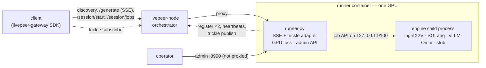
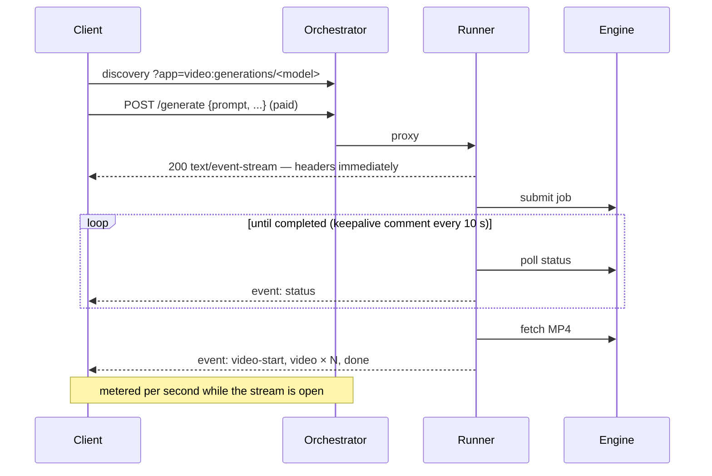
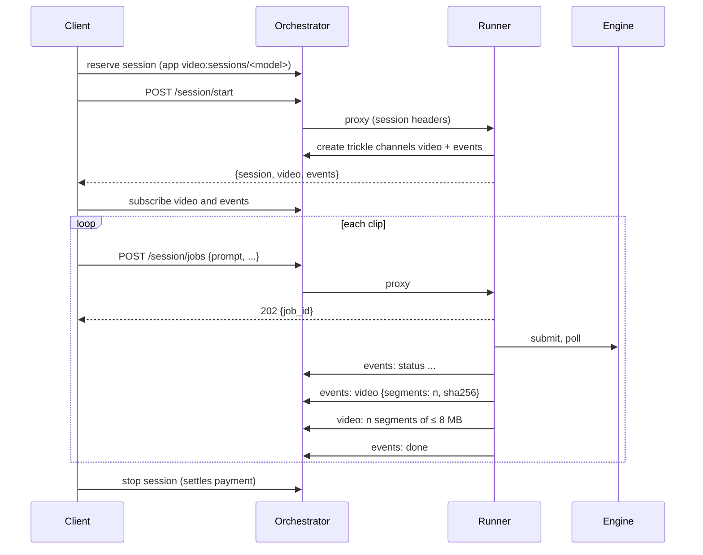
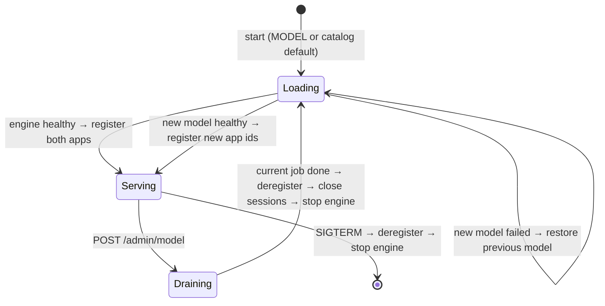

# livepeer-video-engine-runners

[](https://github.com/Cloud-SPE/livepeer-video-engine-runners/actions/workflows/ci.yml)
[](LICENSE)
[](pyproject.toml)
[](https://github.com/livepeer/node)
[](compose.yml)
[](https://github.com/astral-sh/uv)
[](https://github.com/astral-sh/ruff)
[](https://github.com/psf/black)
[](#project-status)
[](CONTRIBUTING.md)

Run off-the-shelf video generation servers — [LightX2V](https://github.com/ModelTC/LightX2V), [SGLang Diffusion](https://docs.sglang.io/diffusion/installation.html) and [vLLM-Omni](https://docs.vllm.ai/projects/vllm-omni/en/latest/serving/videos_api/) — as **Livepeer live runners**. One runner process per GPU starts an engine, registers it with a [livepeer-node](https://github.com/livepeer/node) orchestrator, and sells text-to-video on the network two ways: a **single call** that streams the clip back over Server-Sent Events, or a **held session** that renders clip after clip into trickle channels. Operators switch the served model at runtime without touching the orchestrator.

A CPU **stub engine** speaks the same job APIs, so the whole network path runs on a laptop without a GPU.

## Contents

- [Project status](#project-status)
- [Why this exists](#why-this-exists)
- [Features](#features)
- [Engines and models](#engines-and-models)
- [Quick start (no GPU)](#quick-start-no-gpu)
- [Architecture](#architecture)
- [Network API](#network-api)
- [Configuration](#configuration)
- [Build](#build)
- [Deploy](#deploy)
- [Operations](#operations)
- [Development](#development)
- [Conventions](#conventions)
- [Known issues and limitations](#known-issues-and-limitations)
- [Roadmap](#roadmap)
- [Contributing](#contributing)
- [Security](#security)
- [License](#license)
- [Acknowledgements](#acknowledgements)

## Project status

**Experimental.** Everything below is tested end to end with the stub engine against livepeer-node (unit tests, and CI runs the full network path on every change). **None of the three GPU engines has been run through the runner on a GPU yet.** The engine clients follow each project's documented API and current source (LightX2V `8e86555`, SGLang `3b72b70`), but expect to adjust catalog flags, image tags and request defaults on the first GPU runs. [GPU validation reports](.github/ISSUE_TEMPLATE/engine_or_model.yml) are the most useful contribution right now.

## Why this exists

Livepeer's live runners let any HTTP service sell GPU time through an orchestrator: the runner registers an _app_, clients find it through discovery, and the orchestrator proxies and meters the traffic. Video generation servers fit that model badly out of the box:

- **They are slow and asynchronous.** A clip takes seconds to many minutes. The engines expose submit → poll → fetch job APIs, while the orchestrator gives a proxied request **60 seconds to send response headers**. A client that polls instead pays only for the polls, not the render.
- **One GPU, one job.** A diffusion model saturates the card. Requests must be admitted, refused or queued deliberately, and refusing must happen _before_ a caller is billed for waiting.
- **Clips are large.** An MP4 can exceed livepeer-node's 10 MB trickle segment limit, and a channel keeps only its last five segments.
- **Models change.** Operators want to serve a different model next week, or this afternoon, without redeploying the orchestrator or leaving a stale registration behind.
- **Every engine speaks its own API.** LightX2V has `/v1/tasks`; SGLang Diffusion and vLLM-Omni share an OpenAI-style `/v1/videos`.

This repository is the adapter: one small runner that hides the engine's job API behind two network-friendly delivery modes, enforces one-job-per-GPU admission, splits video to the transport's limits, and supervises the engine process so models can be swapped safely.

## Features

- **Three engines, one interface** — LightX2V, SGLang Diffusion, vLLM-Omni, plus a CPU stub. Adding an engine with an async job API is one small class.
- **Two delivery modes from one GPU** — single-shot over SSE and persistent sessions over trickle, registered side by side and sharing one GPU lock.
- **Billing that matches the work** — metered per second for as long as the clip renders (single-shot) or the session is held (persistent). Busy requests are refused immediately, not queued while billed.
- **Runtime model switching** — an authenticated admin endpoint drains the GPU, deregisters, restarts the engine with another catalog model, re-registers, and rolls back if the new model fails to load.
- **Safe failure** — a client that disconnects cancels the engine job; abandoned sessions are released after an idle timeout; `SIGTERM` stops the engine's whole process group and deregisters.
- **Large clips** — MP4s are split into 8 MB trickle segments (single-shot: 512 KB base64 SSE chunks) with a SHA-256 the client verifies.
- **Reproducible** — the orchestrator is built from a pinned livepeer-node commit; runner dependencies install from `uv.lock`; engine images and sources are pinned.

## Engines and models

Each engine has a **catalog** in [`models/`](models) listing the models it can serve. The runner serves one at a time.

| Engine (`ENGINE`) | Job API                    | Model id (catalog default in **bold**) | Upstream weights                                   | Notes                                         |
| ----------------- | -------------------------- | -------------------------------------- | -------------------------------------------------- | --------------------------------------------- |
| `sglang`          | `/v1/videos` (OpenAI-like) | **`fastwan2.1-t2v-1.3b`**              | `FastVideo/FastWan2.1-T2V-1.3B-Diffusers`          | Distilled, 3 steps                            |
|                   |                            | `wan2.1-t2v-1.3b`                      | `Wan-AI/Wan2.1-T2V-1.3B-Diffusers`                 | 30 steps, text encoder offloaded to CPU       |
| `vllm-omni`       | `/v1/videos` (OpenAI-like) | **`wan2.2-ti2v-5b`**                   | `Wan-AI/Wan2.2-TI2V-5B-Diffusers`                  | 24 fps                                        |
|                   |                            | `wan2.2-t2v-a14b`                      | `Wan-AI/Wan2.2-T2V-A14B-Diffusers`                 | MoE 14B; needs a large card or offload        |
| `lightx2v`        | `/v1/tasks` (LightX2V)     | **`wan2.1-t2v-1.3b`**                  | Local dir `/models/Wan2.1-T2V-1.3B`                | SageAttention 2                               |
|                   |                            | `minimax-h3-4step`                     | Local `/models/MiniMax-H3` + INT8 DiT + Turbo LoRA | 4-step, block offload; minutes per clip       |
| `stub`            | both (CPU)                 | **`stub-wan-t2v`**, `stub-h3`          | none                                               | Test pattern; `stub-h3` uses the LightX2V API |

Weights from Hugging Face download into `HF_CACHE_DIR` on first start. LightX2V entries read local directories under `MODELS_DIR`; see [`models/lightx2v.json`](models/lightx2v.json) and [`configs/lightx2v/`](configs/lightx2v) for the exact paths.

### Which GPU?

These are **expectations from the upstream projects, not measurements from this repository** — please [report yours](.github/ISSUE_TEMPLATE/engine_or_model.yml).

| Model                          | RTX 4090 (24 GB)                                   | RTX 5090 (32 GB)           |
| ------------------------------ | -------------------------------------------------- | -------------------------- |
| Wan2.1 T2V 1.3B / FastWan 1.3B | Fits comfortably (upstream quotes ~8 GB at 480p)   | Fits                       |
| Wan2.2 TI2V 5B                 | Fits with offload; upstream targets consumer cards | Fits                       |
| Wan2.2 T2V A14B                | Only with aggressive offload; slow                 | Tight; offload likely      |
| MiniMax-H3 4-step (LightX2V)   | INT8 + block offload; minutes per clip             | Same config; more headroom |

Blackwell (RTX 50) cards need CUDA 12.8+ builds; pick a matching base image (see [Build](#build)). LightX2V's stock FlashAttention 3 configs are Hopper-only, which is why the shipped configs use SageAttention 2.

## Quick start (no GPU)

Requirements: Docker with Compose v2, [uv](https://docs.astral.sh/uv/), and network access to GitHub (the orchestrator is built from source).

```sh
git clone https://github.com/Cloud-SPE/livepeer-video-engine-runners.git
cd livepeer-video-engine-runners

ENGINE=stub docker compose up -d --build --wait     # orchestrator + runner with the stub engine
uv run client.py --list                              # both apps registered
uv run client.py --output fox                        # single-shot  -> fox.mp4
uv run client.py --mode persistent --clips 3 --output fox   # session -> fox-000.mp4 ... fox-002.mp4

# switch the served model at runtime
curl -X POST -H "Authorization: Bearer change-me" \
  http://127.0.0.1:8990/admin/model -d '{"model": "stub-h3"}'
uv run client.py --model stub-h3 --output h3

scripts/e2e.sh                                       # the same checks CI runs
docker compose down
```

The first build compiles livepeer-node, which takes a few minutes.

## Architecture



### Components

| File                               | Role                                                                                                                                                                                                                           |
| ---------------------------------- | ------------------------------------------------------------------------------------------------------------------------------------------------------------------------------------------------------------------------------ |
| [`engines.py`](engines.py)         | The catalog (`ModelSpec`), engine clients (`LightX2VClient`, `OpenAIVideosClient`) behind one `EngineClient.run()` = submit → poll → fetch, and the `EngineSupervisor` that runs the engine. **Knows nothing about Livepeer.** |
| [`runner.py`](runner.py)           | The only Livepeer-aware server code: registration, both delivery modes, GPU admission, sessions, the admin API. Grep `# Livepeer:` for the SDK calls.                                                                          |
| [`client.py`](client.py)           | Reference client for both modes, built on the `livepeer-gateway` SDK. Grep `# Livepeer:`.                                                                                                                                      |
| [`stub_engine.py`](stub_engine.py) | CPU stand-in for both engine APIs; renders a colour-bar MP4 after a delay.                                                                                                                                                     |
| [`models/`](models)                | One catalog per engine.                                                                                                                                                                                                        |
| [`configs/`](configs)              | Engine-side configs referenced by catalog commands (LightX2V JSON configs).                                                                                                                                                    |
| [`docker/`](docker)                | One image per engine: the engine's official image plus an isolated Python 3.12 runner environment in `/opt/runner`.                                                                                                            |
| [`compose.yml`](compose.yml)       | Orchestrator (built from livepeer-node source) + runner on a private network. [`compose.gpu.yml`](compose.gpu.yml) adds one NVIDIA GPU.                                                                                        |

### Single-shot: one call, Server-Sent Events back



Headers leave before the engine starts, so a job of any length meets the 60-second header timeout, and the open stream keeps the call billed. If the client disconnects, the runner cancels the engine job.

### Persistent: hold a session, render many clips



The client reads the video channel continuously (livepeer-node keeps only the last five segments per channel) and assembles each clip from the number of segments its `video` event announces. While a session is open, the runner writes an empty segment to any channel that has been quiet for 60 seconds, because livepeer-node closes a trickle channel after five minutes without a write — shorter than a long render.

### GPU admission

Both modes share one `asyncio.Lock`. With `--busy reject` (default) a request that finds the GPU busy is refused immediately — `503` for single-shot, `409` for a persistent job — so nobody is billed for waiting. The orchestrator also hides a full runner from discovery, so a second caller of the _same_ mode sees `No runners available`. `--busy wait` queues instead (and bills the waiting caller).

### Model switching



While switching, new requests are refused. Switching takes as long as the new model takes to load: seconds for the stub, typically minutes for a real model. That is why it is an operator action rather than a per-request field — a per-request model would let one caller stall the GPU for everyone with a reload. With enough GPUs, run one runner per model instead and never switch.

### Engine supervision

The engine runs as a child process in its **own process group**, listening only on `127.0.0.1:9100` inside the container. The runner registers only after the engine's health endpoint answers, keeps the last 40 lines of engine output for error messages, and on stop sends `SIGTERM` to the whole group (then `SIGKILL` after 30 s), so multi-process engines leave nothing behind.

## Network API

### App ids

App ids follow the Cloud SPE capability convention, `<domain>:<capability>`, with the model appended because livepeer-node discovery filters on the app id alone:

| Mode        | App id                         | Runner endpoints                       |
| ----------- | ------------------------------ | -------------------------------------- |
| single-shot | `video:generations/<model id>` | `POST /generate`                       |
| persistent  | `video:sessions/<model id>`    | `POST /session/start`, `/session/jobs` |

The capability names the runner's endpoint family, the way `openai:images-generations` names `/v1/images/generations`. Model ids name the **model, not the engine**: the same model served by two engines is one offering, and discovery's `version` field reports the engine. App ids, endpoints and event shapes are a public contract; changing them is a breaking change.

### Job request

Both `/generate` and `/session/jobs` take the same JSON body (at most 64 KB). Omitted fields fall back to the model's catalog `defaults`.

| Field             | Type   | Notes                                                           |
| ----------------- | ------ | --------------------------------------------------------------- |
| `prompt`          | string | Required, 1–4000 characters                                     |
| `negative_prompt` | string |                                                                 |
| `width`, `height` | int    | Must be a resolution the model supports                         |
| `num_frames`      | int    | Must be a frame count the model supports (Wan: 4n+1)            |
| `fps`             | int    | OpenAI-style engines only                                       |
| `steps`           | int    | OpenAI-style engines only; LightX2V reads steps from its config |
| `seed`            | int    |                                                                 |

### Single-shot events (`text/event-stream`)

```text
event: accepted     data: {"model": "fastwan2.1-t2v-1.3b"}
event: status       data: {"state": "running", "progress": 40}
: keepalive
event: video-start  data: {"content_type": "video/mp4", "bytes": 1549994, "sha256": "…", "chunks": 3}
event: video        data: {"index": 0, "b64": "…"}           # 512 KB of MP4 per event
event: done         data: {}
event: error        data: {"message": "…"}                   # instead of video/done
```

`state` is one of `queued`, `running`, `completed`, `failed`, `cancelled`; `progress` (0–100) is present when the engine reports it.

### Persistent session

`POST /session/start` → `{"session": "<id>", "video": "<trickle url>", "events": "<trickle url>"}` (idempotent per session).

`POST /session/jobs` → `202 {"job_id": "…", "model": "…"}`. The `events` channel carries JSON Lines:

```json
{"type": "status", "job_id": "…", "state": "running", "progress": 40}
{"type": "video", "job_id": "…", "segments": 2, "bytes": 13959142, "sha256": "…"}
{"type": "done", "job_id": "…"}
{"type": "error", "job_id": "…", "message": "…"}
```

After a `video` event, the next `segments` non-empty segments on the `video` channel are that clip's MP4, in order. Empty segments are keepalives; skip them.

### Errors

| Status | When                                                                   |
| ------ | ---------------------------------------------------------------------- |
| `400`  | Invalid JSON or job fields; missing `Livepeer-Session-Id` header       |
| `404`  | `/session/jobs` before `/session/start`                                |
| `409`  | Persistent job while the GPU is busy, or the session already has a job |
| `503`  | Single-shot while the GPU is busy or the runner is switching models    |

### Informational endpoints

`GET /healthz` → `{"ok": true}` (503 while switching or if the engine died). `GET /models` → the catalog with each model's app ids, engine and defaults, and the current model.

## Configuration

### Compose environment (`.env`)

Copy [`.env.example`](.env.example) to `.env`. Every value has a default.

| Variable               | Default                                      | Meaning                                                                                                    |
| ---------------------- | -------------------------------------------- | ---------------------------------------------------------------------------------------------------------- |
| `ENGINE`               | `stub`                                       | `stub`, `lightx2v`, `sglang` or `vllm-omni`: picks `docker/<engine>.Dockerfile` and `models/<engine>.json` |
| `MODEL`                | catalog default                              | Model id to load at startup                                                                                |
| `DELIVERY`             | `both`                                       | `single-shot`, `persistent` or `both`                                                                      |
| `LIVEPEER_NODE_SOURCE` | `https://github.com/livepeer/node.git#<sha>` | livepeer-node source for the orchestrator image: a git URL pinned to a commit, or a local checkout         |
| `BOOTSTRAP_SECRET`     | `devsecret`                                  | Shared by orchestrator and runner for dynamic registration. **Change it.**                                 |
| `RUNNER_ADMIN_TOKEN`   | `change-me`                                  | Bearer token for the admin API. **Change it.**                                                             |
| `HF_TOKEN`             | empty                                        | For gated Hugging Face models                                                                              |
| `HF_CACHE_DIR`         | `~/.cache/huggingface`                       | Mounted at `/root/.cache/huggingface`                                                                      |
| `MODELS_DIR`           | `./weights`                                  | Mounted at `/models` (LightX2V checkpoints)                                                                |
| `GPU_ID`               | `0`                                          | GPU for `compose.gpu.yml`                                                                                  |
| `SUBNET_PREFIX`        | `172.30.88`                                  | Compose network `/24`; the runner is `.10`. livepeer-node grants take IPs only.                            |

### Runner flags (`runner.py`)

| Flag                           | Default                      | Meaning                                                                              |
| ------------------------------ | ---------------------------- | ------------------------------------------------------------------------------------ |
| `--catalog`                    | `models/stub.json`           | Catalog file                                                                         |
| `--model`                      | catalog `default`            | Model id to load at startup                                                          |
| `--orchestrator`               | `http://localhost:8935`      | Orchestrator to register with                                                        |
| `--secret`                     | `$LIVEPEER_BOOTSTRAP_SECRET` | Bootstrap secret (required)                                                          |
| `--runner-url`                 | `http://127.0.0.1:8989`      | URL the orchestrator proxies to; must be covered by its `--runner-grants` if private |
| `--host`, `--port`             | `127.0.0.1`, `8989`          | Public (proxied) listener                                                            |
| `--admin-host`, `--admin-port` | `127.0.0.1`, `8990`          | Admin listener; never expose it publicly                                             |
| `--delivery`                   | `both`                       | Modes to register                                                                    |
| `--busy`                       | `reject`                     | `reject` refuses while the GPU is busy; `wait` queues (billed)                       |
| `--session-idle-timeout`       | `300`                        | Release a persistent session idle this many seconds; `0` = never                     |

Environment: `LIVEPEER_BOOTSTRAP_SECRET`, `RUNNER_ADMIN_TOKEN` (empty disables the admin API: every request gets `401`).

### Catalog schema (`models/<engine>.json`)

```json
{
  "default": "fastwan2.1-t2v-1.3b",
  "models": [
    {
      "id": "fastwan2.1-t2v-1.3b",
      "engine": "openai-videos",
      "command": [
        "sglang",
        "serve",
        "--model-path",
        "FastVideo/FastWan2.1-T2V-1.3B-Diffusers",
        "--port",
        "9100"
      ],
      "port": 9100,
      "defaults": {
        "width": 832,
        "height": 480,
        "num_frames": 61,
        "fps": 16,
        "steps": 3
      }
    }
  ]
}
```

| Key                  | Default   | Meaning                                                                        |
| -------------------- | --------- | ------------------------------------------------------------------------------ |
| `id`                 | required  | Model id: lowercase letters, digits, `.` and `-`; appears in app ids           |
| `engine`             | required  | API flavour: `lightx2v` or `openai-videos`                                     |
| `command`            | required  | Engine command line; it must listen on `127.0.0.1:<port>`                      |
| `port`               | required  | Engine port                                                                    |
| `health_path`        | `/health` | Engine readiness endpoint                                                      |
| `startup_timeout_s`  | `1800`    | Time allowed for download + load                                               |
| `job_timeout_s`      | `1800`    | Per-clip limit; the engine job is cancelled after it                           |
| `price_usd_per_hour` | `0`       | Advertised for both modes; livepeer-node meters it per second                  |
| `env`                | `{}`      | Extra environment for the engine process                                       |
| `defaults`           | `{}`      | Job request defaults                                                           |
| `served_model`       | empty     | `openai-videos` only: value of the `model` form field, if the server wants one |

### Client (`client.py`)

`--model` (model id), `--mode single-shot|persistent`, `--clips`, `--prompt`, `--width`, `--height`, `--num-frames`, `--steps`, `--seed`, `--output` (file prefix), `--discovery` (default `http://localhost:8935/discovery`), `--signer` (remote signer URL for paid use), `--list`.

## Build

Each image is an engine's official image plus the runner in its own Python 3.12 virtualenv (`/opt/runner`), so the runner's dependencies never touch the engine's torch stack. Runner dependencies install from `uv.lock`.

```sh
docker build -f docker/sglang.Dockerfile -t livepeer-video-engine-runners-sglang .
# or let compose build it:
ENGINE=sglang docker compose -f compose.yml -f compose.gpu.yml build
```

| Image                         | Base (build arg)                                                     | Pin before production                 |
| ----------------------------- | -------------------------------------------------------------------- | ------------------------------------- |
| `docker/stub.Dockerfile`      | `python:3.12-slim`                                                   | —                                     |
| `docker/sglang.Dockerfile`    | `SGLANG_IMAGE=lmsysorg/sglang:latest`                                | **Yes** — use a release tag or digest |
| `docker/vllm-omni.Dockerfile` | `VLLM_OMNI_IMAGE=vllm/vllm-omni:v0.26.0`                             | Validated tag                         |
| `docker/lightx2v.Dockerfile`  | `LIGHTX2V_IMAGE=lightx2v/lightx2v:26011201-cu128`, `LIGHTX2V_COMMIT` | cu130 tags for RTX 50 / Blackwell     |

The orchestrator image is built by compose from livepeer-node's own `docker/Dockerfile` at `LIVEPEER_NODE_SOURCE` (livepeer-node does not publish an image yet). To try another livepeer-node commit, set `LIVEPEER_NODE_SOURCE=https://github.com/livepeer/node.git#<commit>` or a local checkout path.

## Deploy

### One GPU, all in one host (compose)

```sh
cp .env.example .env    # set ENGINE, MODEL, BOOTSTRAP_SECRET, RUNNER_ADMIN_TOKEN, weights paths
docker compose -f compose.yml -f compose.gpu.yml up -d --build --wait
docker compose logs -f runner         # download and load; registration follows readiness
uv run client.py --model fastwan2.1-t2v-1.3b
```

Compose publishes the orchestrator on `127.0.0.1:8935` and the admin API on `127.0.0.1:8990` only. To serve the network, put the orchestrator behind TLS (below).

### Several GPUs, or an existing orchestrator

Run one runner container per GPU and point each at your orchestrator. Each runner needs a URL the orchestrator can reach; private addresses must be granted on the orchestrator (`--runner-grants 10.0.0.5` permits every port on that IP).

```sh
for gpu in 0 1; do
  docker run -d --name video-runner-gpu$gpu --restart unless-stopped \
    --gpus "device=$gpu" --ipc host \
    -e LIVEPEER_BOOTSTRAP_SECRET -e RUNNER_ADMIN_TOKEN -e HF_TOKEN \
    -v ~/.cache/huggingface:/root/.cache/huggingface -v /srv/models:/models \
    -p 10.0.0.5:$((8989 + 2*gpu)):8989 -p 127.0.0.1:$((8990 + 2*gpu)):8990 \
    livepeer-video-engine-runners-sglang \
    --host 0.0.0.0 --admin-host 0.0.0.0 --catalog models/sglang.json \
    --orchestrator https://orchestrator.example.com \
    --runner-url http://10.0.0.5:$((8989 + 2*gpu))
done
```

Give each GPU a different `--model` to offer several models at once without switching.

### The orchestrator

Follow livepeer-node's [orchestrator guide](https://github.com/livepeer/node/blob/main/docs/orchestrator.md). In short:

- `--listen` on an interface, and terminate TLS in a reverse proxy; set `--service-url` to the public HTTPS URL.
- Prefer `--bootstrap-secret-file` over the environment variable.
- `--runner-grants` for runners on private addresses (IPs only, not hostnames).
- `--runner-service-url` if runners reach the orchestrator at a different address than clients do.

### Paid (on-chain) operation

Off-chain (the default) is free: prices are accepted but discovery advertises the runner as free. For paid use, configure payments on the orchestrator ([livepeer-node configuration](https://github.com/livepeer/node/blob/main/docs/configuration.md)), set `price_usd_per_hour` per catalog model, and have clients pass `--signer`. A single-shot call is billed while its SSE stream is open; a session is billed until it is released, including idle time between clips. A request refused as busy has already paid the challenge's upfront amount (about ten seconds of the price). The on-chain path has not been exercised with these runners yet.

## Operations

```sh
# status: current model, GPU busy, open sessions, registrations
curl -H "Authorization: Bearer $RUNNER_ADMIN_TOKEN" http://127.0.0.1:8990/admin/status

# switch model (blocks until the new model is serving; restores the old one on failure)
curl -X POST -H "Authorization: Bearer $RUNNER_ADMIN_TOKEN" \
  http://127.0.0.1:8990/admin/model -d '{"model": "minimax-h3-4step"}'

# what the network sees
uv run client.py --list --discovery https://orchestrator.example.com/discovery
```

- **Logs:** the runner logs engine output prefixed with the model id, registrations, sessions and every request.
- **Stopping:** `docker stop` (SIGTERM) deregisters both apps and stops the engine's process group within 30 s.
- **Abandoned sessions:** released after `--session-idle-timeout`; off-chain sessions never expire on their own.
- **Health:** container health and `GET /healthz` report the engine; the orchestrator also drops runners that miss heartbeats (30 s).

## Development

```sh
uv sync                                   # Python env with dev tools
uv run pytest                             # unit tests: catalogs, engine clients vs the stub, trickle publisher
ENGINE=stub docker compose up -d --build --wait && scripts/e2e.sh   # full network path
uvx pre-commit run --all-files            # black, ruff, prettier, whitespace
```

Run the runner without Docker (needs Go to build livepeer-node):

```sh
git clone https://github.com/livepeer/node.git ../node
(cd ../node && go build -o bin/livepeer-orchestrator ./cmd/livepeer-orchestrator)
LIVEPEER_ORCHESTRATOR_BOOTSTRAP_SECRET=devsecret ../node/bin/livepeer-orchestrator \
  --config= --runner-grants 127.0.0.1:8989 &
LIVEPEER_BOOTSTRAP_SECRET=devsecret RUNNER_ADMIN_TOKEN=change-me \
  uv run runner.py --catalog models/stub.json &
uv run client.py
```

`uv run` matters: the stub catalog's `python` command must resolve to the project environment.

### Adding a model

Add an entry to the engine's catalog, with defaults the model supports, and run it on a GPU. Open a PR with the [GPU report](.github/ISSUE_TEMPLATE/engine_or_model.yml) details.

### Adding an engine

1. Subclass `EngineClient` in `engines.py` (`submit`, `status`, `fetch`, `cancel`) and add its name to `ENGINE_KINDS` and `engine_client()`.
2. Teach `stub_engine.py` the API so the network path stays testable without a GPU, and add a stub catalog entry for it.
3. Add `docker/<engine>.Dockerfile` and `models/<engine>.json`.
4. Add tests, and document the engine here.

## Conventions

- **Layering.** `engines.py` never imports Livepeer code; `runner.py` and `client.py` are the only files that do, and mark each SDK call with `# Livepeer: n`.
- **Python.** 3.12+, `from __future__ import annotations`, type hints, `black` formatting and `ruff` linting (enforced by pre-commit and CI). Comments explain _why_, not what.
- **Identifiers.** Model ids are lowercase upstream names (`wan2.2-ti2v-5b`), engine-agnostic. App ids are `video:generations/<model>` and `video:sessions/<model>`. Engines listen on `127.0.0.1:9100` inside the container.
- **Catalogs** hold everything model-specific: commands, defaults, timeouts, prices. Code changes should not be needed to add a model.
- **Pinning.** Every external input is pinned: livepeer-node commit, engine base images and sources, `uv.lock`, CI actions.
- **Commits.** Imperative, sentence-case summaries that say what changes for the reader ("Release abandoned sessions after an idle timeout"); body explains why. One logical change per commit.
- **Versioning.** [Semantic Versioning](https://semver.org/). App ids, endpoints, event shapes, catalog keys and CLI flags are the public contract; breaking any of them is a major version. Changes are recorded in [CHANGELOG.md](CHANGELOG.md) ([Keep a Changelog](https://keepachangelog.com/)).

## Known issues and limitations

- **Not GPU-validated yet** — see [Project status](#project-status).
- **Trickle publishing bypasses the SDK publisher.** `livepeer-gateway`'s `TricklePublisher` opens each segment's upload before it has data, but aiohttp sends request headers only with the first body byte; livepeer-node then times the idle connection out (5 s new / 90 s reused) and the next message or clip is lost. The runner sends each segment as one complete request instead (`ChannelPublisher` in `runner.py`). Worth fixing upstream in the SDK.
- **One job per GPU.** No batching across requests; each runner advertises capacity 1 per mode.
- **`--busy reject` is per runner.** Two runners on one GPU, or several orchestrators, are not coordinated.
- **Request fields are best effort per engine.** LightX2V takes steps from its config; resolutions and frame counts must be ones the model supports.
- **Clip-based, not real-time.** These engines render whole clips. Real-time streaming models (Self-Forcing, StreamDiffusionV2, …) need a frame-streaming runner, not this one.
- **Tested against livepeer-node only**, not go-livepeer.

## Roadmap

- GPU validation on RTX 4090 and RTX 5090 for each catalog model; pin image tags and record timings here.
- Publish runner images to GHCR, and a self-hosted GPU workflow for release checks.
- Image-to-video (TI2V) inputs, and audio for MiniMax-H3.
- Upstream fixes: SDK trickle preconnect; a published livepeer-node image.
- Prometheus metrics (jobs, durations, refusals, engine restarts).

## Contributing

Contributions are welcome — especially GPU reports, catalog entries and engines. Read [CONTRIBUTING.md](CONTRIBUTING.md) for the development workflow, testing expectations and review process. Everyone participating is expected to follow the [Code of Conduct](CODE_OF_CONDUCT.md).

## Security

Do not open public issues for vulnerabilities; see [SECURITY.md](SECURITY.md). Operational must-dos: change `BOOTSTRAP_SECRET` and `RUNNER_ADMIN_TOKEN`, never expose the admin port (8990), and keep runner ports reachable only by your orchestrator.

## License

[MIT](LICENSE) © 2026 Cloud SPE. Engines and model weights are separate projects under their own licenses — check each model's license before selling it on the network.

## Acknowledgements

[Livepeer](https://livepeer.org) and [livepeer-node](https://github.com/livepeer/node); [LightX2V](https://github.com/ModelTC/LightX2V); [SGLang](https://github.com/sgl-project/sglang); [vLLM-Omni](https://github.com/vllm-project/vllm-omni); [Wan](https://github.com/Wan-Video), [FastVideo](https://github.com/hao-ai-lab/FastVideo) and MiniMax for the models.
