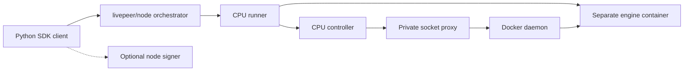
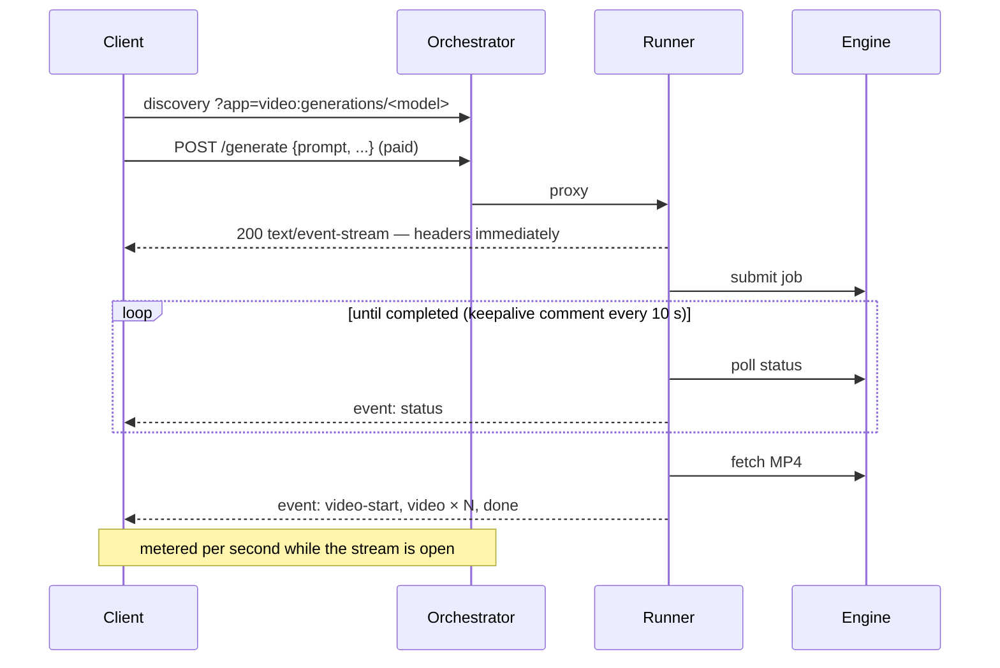
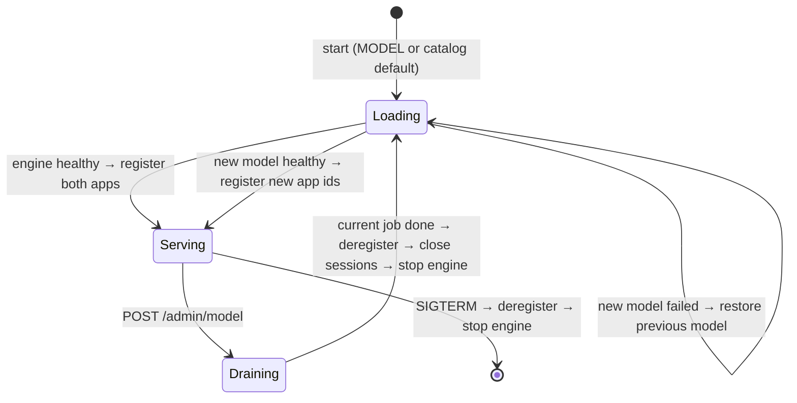

# livepeer-video-engine-runners

[](https://github.com/Cloud-SPE/livepeer-video-engine-runners/actions/workflows/ci.yml)
[](LICENSE)
[](pyproject.toml)
[](https://github.com/livepeer/node)
[](compose.dev.yml)
[](https://github.com/astral-sh/uv)
[](https://github.com/astral-sh/ruff)
[](https://github.com/psf/black)
[](#project-status)
[](CONTRIBUTING.md)

Run off-the-shelf video generation servers — [LightX2V](https://github.com/ModelTC/LightX2V), [SGLang Diffusion](https://docs.sglang.io/diffusion/installation.html) and [vLLM-Omni](https://docs.vllm.ai/projects/vllm-omni/en/latest/serving/videos_api/) — as **Livepeer live runners**. One runner process per GPU starts an engine, registers it with a [livepeer-node](https://github.com/livepeer/node) orchestrator, and sells text-to-video on the network two ways: a **single call** that streams the clip back over Server-Sent Events, or a **held session** that renders clip after clip into trickle channels. Operators switch the served model at runtime without touching the orchestrator.

A CPU **stub engine** speaks the same job APIs, so the whole network path runs on a laptop without a GPU.

The optional [quality harness](docs/guides/video-quality.md) generates repeatable
SDK workloads, evaluates saved clips and builds blind A/B review galleries.
Quality experiments retain the existing model profiles and deployment defaults.

Use [compose.prod.yml](compose.prod.yml) for a provider connected to your existing orchestrator, or [compose.dev.yml](compose.dev.yml) for a complete free local stack with a CPU test engine. Both use the existing managed lifecycle. Bundled and external modes remain available as advanced recipes. The [deployment guide](docs/guides/container-deployment.md) covers initialization, GPU preparation, persistent volumes and startup. Combined catalogs use engine-prefixed model IDs; per-engine deployments keep the IDs below.

The [node deployment guide](docs/guides/node-deployment.md) explains the two `livepeer/node` roles: orchestrator and remote signer. The Python SDK uses the signer for discovery/payments and calls applications through the orchestrator; no separate traditional gateway process is required.

For contributors, start with the [repository map](AGENTS.md), [current architecture](ARCHITECTURE.md) and [documentation index](docs/index.md). Run `scripts/check.sh` for fast local verification; the [validation matrix](docs/validation/index.md) distinguishes automated contracts, recorded hardware results and pending checks.

The [configuration guide](docs/guides/configuration.md) explains catalog sources, pin checks and regeneration. Python options and public fields are listed in the [generated reference](docs/reference/configuration.md).

## Contents

- [Project status](#project-status)
- [Why this exists](#why-this-exists)
- [Features](#features)
- [Engines and models](#engines-and-models)
- [Quick start (no GPU)](#quick-start-no-gpu)
- [Architecture](#architecture)
- [Network API](#network-api)
- [Configuration](#configuration)
- [Build](#build)
- [Deploy](#deploy)
- [Operations](#operations)
- [Development](#development)
- [Conventions](#conventions)
- [Known issues and limitations](#known-issues-and-limitations)
- [Roadmap](#roadmap)
- [Contributing](#contributing)
- [Security](#security)
- [License](#license)
- [Acknowledgements](#acknowledgements)

## Project status

**Experimental.** The three default GPU models have generated real RTX 5090 videos in both delivery modes through the free `livepeer/node` orchestrator. Reports cover [initial generation](docs/validation/reports/gpu-validation-2026-10-15.md) and [832×480 workloads with 12 recovery cases](docs/validation/reports/operations-validation-2026-10-15.md). A [historical paid compatibility trial](docs/validation/reports/paid-validation-2026-10-15.md) used legacy go-livepeer. [Paid single-shot SSE verification](docs/validation/reports/node-paid-validation-2026-10-16.md) now passes for all three defaults through the node orchestrator, local node signer and direct LAN HTTP, without SSH tunnels. Paid persistent delivery remains unvalidated. The optional LightWan 2.2 A14B NVFP4 profile also has a [480p/720p SDK pilot](docs/validation/reports/video-quality-2026-10-16.md). Other larger profiles, public HTTPS, long-duration operation and final settlement remain unvalidated. Quality-pilot clips remain private for review; protected wallet/model volumes and key files are preserved.

## Why this exists

Livepeer's live runners let any HTTP service sell GPU time through an orchestrator: the runner registers an _app_, clients find it through discovery, and the orchestrator proxies and meters the traffic. Video generation servers fit that model badly out of the box:

- **They are slow and asynchronous.** A clip takes seconds to many minutes. The engines expose submit → poll → fetch job APIs, while the orchestrator gives a proxied request **60 seconds to send response headers**. A client that polls instead pays only for the polls, not the render.
- **One GPU, one job.** A diffusion model saturates the card. Requests must be admitted, refused or queued deliberately, and refusing must happen _before_ a caller is billed for waiting.
- **Clips are large.** An MP4 can exceed livepeer-node's 10 MB trickle segment limit, and a channel keeps only its last five segments.
- **Models change.** Operators want to serve a different model next week, or this afternoon, without redeploying the orchestrator or leaving a stale registration behind.
- **Every engine speaks its own API.** LightX2V has `/v1/tasks`; SGLang Diffusion and vLLM-Omni share an OpenAI-style `/v1/videos`.

This repository is the adapter: one small runner that hides the engine's job API behind two network-friendly delivery modes, enforces one-job-per-GPU admission, splits video to the transport's limits, and supervises the engine process so models can be swapped safely.

## Features

- **Three engines, one interface** — LightX2V, SGLang Diffusion, vLLM-Omni, plus a CPU stub. Adding an engine with an async job API is one small class.
- **Two delivery modes from one GPU** — single-shot over SSE and persistent sessions over trickle, registered side by side and sharing one GPU lock.
- **Billing that matches the work** — metered while a single-shot stream or persistent reservation remains open. Busy rejection avoids a render queue; upfront charges and reserved-session time can still apply.
- **Runtime model switching** — an authenticated admin endpoint drains the GPU, deregisters, restarts the engine with another catalog model, re-registers, and rolls back if the new model fails to load.
- **Safe failure** — disconnects request cancellation; uncertain work resets an owned engine before readmission. External engines require operator recovery. Idle sessions expire, and graceful shutdown deregisters and stops owned engines.
- **Large clips** — MP4s are split into 8 MiB trickle segments (single-shot: 256 KiB binary chunks encoded as base64 SSE) with a SHA-256 the client verifies.
- **Reproducible managed deployment** — node source, managed engine images, weight revisions and dependencies are pinned. Bundled Dockerfiles retain configurable base-image arguments; pin those before deployment.

## Engines and models

Each engine has a **catalog** in [`models/`](models) listing the models it can serve. The runner serves one at a time.

| Engine (`ENGINE`) | Job API                    | Model id (catalog default in **bold**) | Upstream weights                                   | Notes                                         |
| ----------------- | -------------------------- | -------------------------------------- | -------------------------------------------------- | --------------------------------------------- |
| `sglang`          | `/v1/videos` (OpenAI-like) | **`fastwan2.1-t2v-1.3b`**              | `FastVideo/FastWan2.1-T2V-1.3B-Diffusers`          | Distilled, 3 steps                            |
|                   |                            | `wan2.1-t2v-1.3b`                      | `Wan-AI/Wan2.1-T2V-1.3B-Diffusers`                 | 30 steps, text encoder offloaded to CPU       |
| `vllm-omni`       | `/v1/videos` (OpenAI-like) | **`wan2.2-ti2v-5b`**                   | `Wan-AI/Wan2.2-TI2V-5B-Diffusers`                  | 24 fps; CPU offload + VAE tiling              |
|                   |                            | `wan2.2-t2v-a14b`                      | `Wan-AI/Wan2.2-T2V-A14B-Diffusers`                 | MoE 14B; needs a large card or offload        |
| `lightx2v`        | `/v1/tasks` (LightX2V)     | **`wan2.1-t2v-1.3b`**                  | Local dir `/models/Wan2.1-T2V-1.3B`                | SageAttention 2                               |
|                   |                            | `minimax-h3-4step`                     | Local `/models/MiniMax-H3` + INT8 DiT + Turbo LoRA | 4-step, block offload; minutes per clip       |
|                   |                            | `lightwan2.2-t2v-a14b-nvfp4`           | Local Wan 2.2 base + LightWan NVFP4 experts        | 4 trained steps; 480p/720p 5090 pilot         |
| `stub`            | both (CPU)                 | **`stub-wan-t2v`**, `stub-h3`          | none                                               | Test pattern; `stub-h3` uses the LightX2V API |

Bundled engines download Hugging Face weights into `HF_CACHE_DIR` on first start. Separate deployments default to offline operation and require weights to be staged first. LightX2V entries read local directories under `MODELS_DIR`; see the [weights instructions](docs/guides/container-deployment.md#stage-images-and-pinned-weights), [`models/lightx2v.json`](models/lightx2v.json), and [`configs/lightx2v/`](configs/lightx2v) for the exact paths.

### Which GPU?

Hardware evidence covers the three **default** models and the optional LightWan
A14B NVFP4 pilot on one RTX 5090. The
[workload report](docs/validation/reports/operations-validation-2026-10-15.md)
records model settings, frame counts, latency and memory; it does not establish
support for every catalog model or GPU. The [quality pilot](docs/validation/reports/video-quality-2026-10-16.md)
records the larger profile and its narrow 720p VRAM headroom. RTX 4090, other
optional models and concurrent multi-GPU deployments still need hardware validation.

Use the managed image pins in [`configs/engine-images.json`](configs/engine-images.json)
with a compatible NVIDIA driver and Container Toolkit. Review host RAM as well
as VRAM: the trusted SGLang profile allows 48 GiB of host memory. Bundled image
base arguments remain operator-selected and require separate pinning and checks.

## Quick start (no GPU)

Requirements: Docker Compose 2.24.4+, Python 3.12+, [uv](https://docs.astral.sh/uv/), and network access for the pinned node build.

```sh
git clone https://github.com/Cloud-SPE/livepeer-video-engine-runners.git
cd livepeer-video-engine-runners
uv sync --locked
mkdir -p "$HOME/.config/livepeer-video"
VIDEO_ENV="$HOME/.config/livepeer-video/dev.env"
python3 src/video_runners/tools/init_deployment.py --engine stub \
  --project video-dev --env-file "$VIDEO_ENV"
docker compose --env-file "$VIDEO_ENV" -f compose.dev.yml up -d --build --wait
uv run video-client --list
uv run video-client --output fox
uv run video-client --mode persistent --clips 3 --output fox-session
# Stop the runner first so its controller-managed engine is deactivated.
docker compose --env-file "$VIDEO_ENV" -f compose.dev.yml stop -t 150 runner
docker compose --env-file "$VIDEO_ENV" -f compose.dev.yml down
```

The first build compiles the pinned node source. The initializer creates random credentials, available ports/subnets and external volumes without overwriting an existing env file. If port 8935 was occupied, pass the generated `ORCHESTRATOR_PORT` as `--discovery http://127.0.0.1:PORT/discovery` to the client. The free stack needs no keys, GPU or model downloads. See the [deployment guide](docs/guides/container-deployment.md) for GPU and production startup; use `tests/e2e/managed.sh` for an isolated, self-cleaning integration run.

## Architecture

The everyday stacks use a CPU runner and controller with a separate engine container, controlled through the private Docker socket proxy. Production connects to your existing orchestrator; development starts a local free node. The runner CLI still supports bundled child-process and external engine ownership. Runtime defaults and both delivery modes remain unchanged.



### Components

The implementation lives in [src/video_runners/](src/video_runners). Use the installed runtime commands and real paths; root forwarding modules and symlink aliases have been removed. The [architecture map](ARCHITECTURE.md) explains boundaries, and the [layout guide](docs/guides/repository-layout.md) maps old commands to their replacements.

### Single-shot: one call, Server-Sent Events back



Headers leave before the engine starts, satisfying the header deadline while the open stream keeps the call billed. If the client disconnects, the runner requests cancellation and resets an owned engine when its idle state cannot be established.

### Persistent: hold a session, render many clips


The client reads the video channel continuously (livepeer-node keeps only the last five segments per channel) and assembles each clip from the number of segments its `video` event announces. While a session is open, the runner writes an empty segment to any channel that has been quiet for 60 seconds, because livepeer-node closes a trickle channel after five minutes without a write — shorter than a long render.

### GPU admission

Both modes share one `asyncio.Lock`. With `--busy reject` (default), busy work is refused immediately — `503` for single-shot, `409` for a persistent job — without entering a render queue. Paid callers can still incur the orchestrator's upfront minimum before the runner refuses them. A persistent reservation also remains billable until released. The orchestrator hides a full app from discovery, so a second caller of the same mode can see `No runners available`. `--busy wait` queues instead and bills waiting time.

### Model switching



While switching, new requests are refused. Switching takes as long as the new model takes to load: seconds for the stub, typically minutes for a real model. That is why it is an operator action rather than a per-request field — a per-request model would let one caller stall the GPU for everyone with a reload. With enough GPUs, run one runner per model instead and never switch.

### Engine supervision

In bundled mode the engine runs in its own process group on loopback. The supervisor keeps the last 40 log lines and sends `SIGTERM`, followed by `SIGKILL` after 30 seconds if needed. Managed mode delegates container creation, readiness and shutdown to the controller. External mode monitors a separately owned backend and leaves its lifecycle to the operator. Registration follows readiness in every mode.

## Network API

### App ids

App ids follow the Cloud SPE capability convention, `<domain>:<capability>`, with the model appended because livepeer-node discovery filters on the app id alone:

| Mode        | App id                         | Runner endpoints                       |
| ----------- | ------------------------------ | -------------------------------------- |
| single-shot | `video:generations/<model id>` | `POST /generate`                       |
| persistent  | `video:sessions/<model id>`    | `POST /session/start`, `/session/jobs` |

The capability names the runner's endpoint family, the way `openai:images-generations` names `/v1/images/generations`. Per-engine catalogs use upstream-style model IDs. The combined catalog prefixes IDs with `sglang-`, `lightx2v-` or `vllm-omni-`, so those engine offerings have distinct app IDs. Discovery's `version` field reports the API adapter (`openai-videos` or `lightx2v`), not the engine product or release. App ids, endpoints and event shapes are a public contract; changing them is a breaking change.

### Job request

Both `/generate` and `/session/jobs` take the same JSON object (at most 64 KiB). Omitted fields fall back to the model's catalog `defaults`.

| Field             | Type   | Notes                                                                 |
| ----------------- | ------ | --------------------------------------------------------------------- |
| `prompt`          | string | Required, 1–4000 characters                                           |
| `negative_prompt` | string |                                                                       |
| `width`, `height` | int    | Non-negative integers; choose a resolution the backend model supports |
| `num_frames`      | int    | Non-negative integer; backend-specific frame rules still apply        |
| `fps`             | int    | OpenAI-style engines only                                             |
| `steps`           | int    | OpenAI-style engines only; LightX2V reads steps from its config       |
| `seed`            | int    |                                                                       |

### Single-shot events (`text/event-stream`)

```text
event: accepted     data: {"model": "fastwan2.1-t2v-1.3b"}
event: status       data: {"state": "running", "progress": 40}
: keepalive
event: video-start  data: {"content_type": "video/mp4", "bytes": 786432, "sha256": "…", "chunks": 3}
event: video        data: {"index": 0, "b64": "…"}           # up to 256 KiB of MP4 per event
event: done         data: {}
event: error        data: {"message": "…"}                   # instead of video/done
```

`state` is one of `queued`, `running`, `completed`, `failed`, `cancelled`; `progress` is a percentage when the engine reports it, otherwise `null`.

### Persistent session

`POST /session/start` → `{"session": "<id>", "video": "<trickle url>", "events": "<trickle url>"}` (idempotent per session).

`POST /session/jobs` → `202 {"job_id": "…", "model": "…"}`. The `events` channel carries JSON Lines:

```json
{"type": "status", "job_id": "…", "state": "running", "progress": 40}
{"type": "video", "job_id": "…", "segments": 2, "bytes": 13959142, "sha256": "…"}
{"type": "done", "job_id": "…"}
{"type": "error", "job_id": "…", "message": "…"}
```

After a `video` event, the next `segments` non-empty segments on the `video` channel are that clip's MP4, in order. Empty segments are keepalives; skip them.

### Errors

| Status | When                                                                    |
| ------ | ----------------------------------------------------------------------- |
| `400`  | Invalid JSON or job fields; missing `Livepeer-Session-Id` header        |
| `404`  | `/session/jobs` before `/session/start`                                 |
| `409`  | Persistent job while busy/unavailable, or the session already has a job |
| `503`  | Single-shot while busy/unavailable; persistent start while unregistered |

### Informational endpoints

`GET /healthz` → `{"ok": true}` when the engine is available and apps are registered; otherwise `{"ok": false}` with HTTP 503. `GET /models` → the catalog with each model's app ids, engine and defaults, and the current model.

## Configuration

### Compose environment (`.env`)

Use the initializer to create private settings and external volumes. [`.env.example`](.env.example) documents local development settings; [the production example](deploy/templates/prod.env.example) lists the existing-node connection fields. Managed mode uses named model/cache/state volumes and a reserved GPU UUID for real engines. Bundled mode retains `HF_CACHE_DIR`, `MODELS_DIR` and `GPU_ID`.

The [deployment guide](docs/guides/container-deployment.md) owns Compose setup and storage settings. The [generated reference](docs/reference/configuration.md) lists Python flags and catalog fields. Engine selection is `ENGINE=stub|sglang|lightx2v|vllm-omni|all`; `all` is managed-only. Production defaults to `all`, development to `stub`. Both retain `DELIVERY=both` unless explicitly changed.

### Runner flags (`video-runner`)

| Flag                           | Default                      | Meaning                                                                              |
| ------------------------------ | ---------------------------- | ------------------------------------------------------------------------------------ |
| `--catalog`                    | `models/stub.json`           | Catalog file                                                                         |
| `--lifecycle`                  | `bundled`                    | `bundled`, `external`, or `managed` engine ownership                                 |
| `--engine-url`                 | empty                        | Required HTTP origin for an external engine                                          |
| `--controller-url`             | `http://controller:9200`     | Managed controller origin (Compose configures its control-network alias)             |
| `--controller-token`           | `$ENGINE_CONTROLLER_TOKEN`   | Managed controller authentication; at least 32 characters                            |
| `--model`                      | catalog `default`            | Model id to load at startup                                                          |
| `--orchestrator`               | `http://localhost:8935`      | Orchestrator to register with                                                        |
| `--secret`                     | `$LIVEPEER_BOOTSTRAP_SECRET` | Bootstrap secret (required)                                                          |
| `--runner-url`                 | `http://127.0.0.1:8989`      | URL the orchestrator proxies to; must be covered by its `--runner-grants` if private |
| `--host`, `--port`             | `127.0.0.1`, `8989`          | Public (proxied) listener                                                            |
| `--admin-host`, `--admin-port` | `127.0.0.1`, `8990`          | Admin listener; never expose it publicly                                             |
| `--delivery`                   | `both`                       | Modes to register                                                                    |
| `--busy`                       | `reject`                     | `reject` refuses while the GPU is busy; `wait` queues (billed)                       |
| `--session-idle-timeout`       | `300`                        | Release a persistent session idle this many seconds; `0` = never                     |

Environment: `LIVEPEER_BOOTSTRAP_SECRET`, `RUNNER_ADMIN_TOKEN` (empty disables the admin API: every request gets `401`).

### Catalog schema (`models/<engine>.json`)

```json
{
  "default": "fastwan2.1-t2v-1.3b",
  "models": [
    {
      "id": "fastwan2.1-t2v-1.3b",
      "engine": "openai-videos",
      "command": [
        "sglang",
        "serve",
        "--model-path",
        "FastVideo/FastWan2.1-T2V-1.3B-Diffusers",
        "--port",
        "9100"
      ],
      "port": 9100,
      "defaults": {
        "width": 832,
        "height": 480,
        "num_frames": 61,
        "fps": 16,
        "steps": 3
      }
    }
  ]
}
```

| Key                        | Default   | Meaning                                                                                       |
| -------------------------- | --------- | --------------------------------------------------------------------------------------------- |
| `id`                       | required  | Model id: lowercase letters, digits, `.` and `-`; appears in app ids                          |
| `engine`                   | required  | API flavour: `lightx2v` or `openai-videos`                                                    |
| `command`                  | required  | Bundled engine command; separate launch tooling binds it to the private engine network.       |
| `port`                     | required  | Engine port                                                                                   |
| `health_path`              | `/health` | Engine readiness endpoint                                                                     |
| `startup_timeout_s`        | `1800`    | Time allowed for download + load                                                              |
| `job_timeout_s`            | `1800`    | Per-clip deadline; requests cancellation and recovers an owned backend when needed.           |
| `price_usd_per_hour`       | `0`       | Advertised for both modes; livepeer-node meters it per second                                 |
| `env`                      | `{}`      | Extra environment for the engine process                                                      |
| `defaults`                 | `{}`      | Job request defaults                                                                          |
| `served_model`             | empty     | `openai-videos` only: value of the `model` form field, if the server wants one                |
| `task`                     | empty     | LightX2V request task, including `t2av` for the MiniMax-H3 base variant                       |
| `supports_negative_prompt` | `true`    | Reject unsupported negative prompts before admission; false for MiniMax-H3 and LightWan NVFP4 |

### Client (`video-client`)

`--model` (model id), `--mode single-shot|persistent`, `--clips`, `--prompt`, `--width`, `--height`, `--num-frames`, `--steps`, `--seed`, `--output` (file prefix), `--discovery` (default `http://localhost:8935/discovery`), `--signer` (remote signer URL for paid use), `--list`.

## Build

Bundled images add the runner to an engine's official image in its own Python 3.12 virtualenv (`/opt/runner`). Separate deployments use [`deploy/docker/cpu.Dockerfile`](deploy/docker/cpu.Dockerfile) for the CPU runner and controller, with a separate optional stub-engine target. These images install locked dependencies without CUDA, PyTorch, or model weights. See [build and deployment commands](docs/guides/container-deployment.md).

```sh
docker build -f deploy/docker/sglang.Dockerfile -t livepeer-video-engine-runners-sglang:local .
# or let compose build it:
ENGINE=sglang docker compose --project-directory . -f deploy/compose/bundled.yml -f deploy/compose/gpu.yml build
```

| Image                                | Base (build arg)                                                     | Pin before production                 |
| ------------------------------------ | -------------------------------------------------------------------- | ------------------------------------- |
| `deploy/docker/stub.Dockerfile`      | `python:3.12-slim`                                                   | —                                     |
| `deploy/docker/sglang.Dockerfile`    | `SGLANG_IMAGE=lmsysorg/sglang:latest`                                | **Yes** — use a release tag or digest |
| `deploy/docker/vllm-omni.Dockerfile` | `VLLM_OMNI_IMAGE=vllm/vllm-omni:v0.26.0`                             | Pin and validate for bundled use      |
| `deploy/docker/lightx2v.Dockerfile`  | `LIGHTX2V_IMAGE=lightx2v/lightx2v:26011201-cu128`, `LIGHTX2V_COMMIT` | Pin a compatible base and validate    |

The orchestrator and signer image is built by Compose from the pinned upstream node's own `docker/Dockerfile` at `LIVEPEER_NODE_SOURCE`. The [image-name table](docs/guides/container-deployment.md#image-names-and-roles) lists all managed, development and preparation images. To try another livepeer-node commit, set `LIVEPEER_NODE_SOURCE=https://github.com/livepeer/node.git#<commit>` or a local checkout path.

## Deploy

Use the [deployment guide](docs/guides/container-deployment.md) for production, complete development, multiple independent GPU instances and advanced bundled/external recipes. GPU models are prepared explicitly into persistent external volumes. Reuse a deployment's exact project, namespace, engine network and controller state when restarting it.

### The orchestrator

Follow the pinned livepeer-node [orchestrator guide](https://github.com/livepeer/node/blob/08081dbda0f4f7b56e362e3af4b6965bfa1b73a4/docs/orchestrator.md):

- `--listen` on an interface, and terminate TLS in a reverse proxy; set `--service-url` to the public HTTPS URL.
- Prefer `--bootstrap-secret-file` over the environment variable.
- `--runner-grants` for runners on private addresses (IPs only, not hostnames).
- `--runner-service-url` if runners reach the orchestrator at a different address than clients do.

### Paid (on-chain) operation

Offchain testing is free and needs no signer. For paid use, configure a `livepeer/node` orchestrator and its payer-side `livepeer signer`, set positive `price_usd_per_hour` values in the public model catalog, and pass `--signer` from the Python client. See the [node deployment guide](docs/guides/node-deployment.md) and optional [`deploy/compose/signer.yml`](deploy/compose/signer.yml). A single-shot call is billed while its SSE stream is open; a persistent reservation is billed until released, including idle time. A busy refusal can still incur an upfront payment. The [node paid trial](docs/validation/reports/node-paid-validation-2026-10-16.md) verifies the three default models through paid single-shot SSE. Paid persistent delivery, redemption and final settlement remain unvalidated; the legacy paid trial does not establish those scopes.

## Operations

```sh
# status: current model, GPU busy, open sessions, registrations
curl -H "Authorization: Bearer $RUNNER_ADMIN_TOKEN" http://127.0.0.1:8990/admin/status

# Switch the default dev stub; choose an ID from your deployed catalog for GPUs.
# Blocks until serving; attempts to restore the old model on failure.
curl -X POST -H "Authorization: Bearer $RUNNER_ADMIN_TOKEN" \
  http://127.0.0.1:8990/admin/model -d '{"model": "stub-h3"}'

# what the network sees
uv run video-client --list --discovery https://orchestrator.example.com/discovery
```

- **Logs:** the runner logs registrations and sessions. Bundled engine output is prefixed with the model id; separate engines have their own container logs.
- **Stopping:** SIGTERM deregisters both apps and releases sessions. Bundled engines get 30 seconds before a forced process-group kill; managed mode requests controller deactivation, which can take longer. Use the [managed shutdown sequence](docs/guides/container-deployment.md#stop-restart-and-update) before removing that stack. External engines remain operator-owned.
- **Abandoned sessions:** the runner releases idle sessions after `--session-idle-timeout`, including offchain sessions. Setting it to `0` disables that runner deadline.
- **Health:** container health and `GET /healthz` report the engine; the orchestrator also drops runners that miss heartbeats (30 s).

## Development

```sh
uv sync                                   # Python env with dev tools
scripts/check.sh                          # links, boundaries, Black, Ruff and CPU unit/contract tests
tests/e2e/managed.sh                      # isolated network/lifecycle checks
uvx pre-commit run --all-files            # black, ruff, prettier, whitespace
```

Run the runner without Docker (needs the Go version required by the pinned node source):

```sh
git clone https://github.com/livepeer/node.git ../node
(cd ../node && git checkout --detach 08081dbda0f4f7b56e362e3af4b6965bfa1b73a4 && go build -o bin/livepeer ./cmd/livepeer)
LIVEPEER_ORCHESTRATOR_BOOTSTRAP_SECRET=devsecret ../node/bin/livepeer orchestrator \
  --config= --listen=127.0.0.1:8935 --service-url=http://127.0.0.1:8935 \
  --runner-grants=127.0.0.1:8989 &
LIVEPEER_BOOTSTRAP_SECRET=devsecret RUNNER_ADMIN_TOKEN=change-me \
  uv run video-runner --catalog models/stub.json &
uv run video-client
```

`uv run` makes the installed `video-stub-engine` command available to the bundled supervisor.

### Adding a model

Add an entry to the engine's catalog, with defaults the model supports, and run it on a GPU. Open a PR with the [GPU report](.github/ISSUE_TEMPLATE/engine_or_model.yml) details.

### Adding an engine

1. Subclass `EngineClient` in `src/video_runners/backends/base.py` (`submit`, `status`, `fetch`, `cancel`), add the adapter under `backends/`, and update `ENGINE_KINDS` in `catalog.py` and `engine_client()` in `backends/__init__.py`.
2. Teach `src/video_runners/stub_engine.py` the API so the network path stays testable without a GPU, and add a stub catalog entry for it.
3. Add `deploy/docker/<engine>.Dockerfile` and `models/<engine>.json`.
4. Add tests, and document the engine here.

## Conventions

- **Layering.** Contracts, catalogs, backends, lifecycle and controller code stay independent of Livepeer. Application integration lives in `src/video_runners/runner/` and `client.py`, with SDK calls marked `# Livepeer: n`. Operator validation tools may use both integrations; runtime imports follow the [architecture](ARCHITECTURE.md#dependency-boundaries).
- **Python.** 3.12+, `from __future__ import annotations`, type hints, `black` formatting and `ruff` linting (enforced by pre-commit and CI). Comments explain _why_, not what.
- **Identifiers.** Per-engine model IDs use lowercase upstream names (`wan2.2-ti2v-5b`); the combined catalog prefixes them with the engine. App IDs are `video:generations/<model>` and `video:sessions/<model>`. Bundled engines listen on loopback; separate engines bind to their private generation network without publishing a host port.
- **Catalogs** hold everything model-specific: commands, defaults, timeouts, prices. Code changes should not be needed to add a model.
- **Pinning.** Managed deployments pin node source, engine images, weight revisions and `uv.lock`. Bundled base images are build arguments; review and pin them before deployment.
- **Commits.** Imperative, sentence-case summaries that say what changes for the reader ("Release abandoned sessions after an idle timeout"); body explains why. One logical change per commit.
- **Versioning.** [Semantic Versioning](https://semver.org/). App ids, endpoints, event shapes, catalog keys and CLI flags are the public contract; breaking any of them requires a major version (a minor version while at 0.x). Changes are recorded in [CHANGELOG.md](CHANGELOG.md) ([Keep a Changelog](https://keepachangelog.com/)).

## Known issues and limitations

- **Limited hardware coverage.** The three default models pass 832×480 workloads and selected recovery cases on one RTX 5090. LightWan A14B NVFP4 also passed a narrow 480p/720p pilot. Paid persistent delivery with the node signer, other larger models, host/daemon outages, long-duration operation and settlement remain unvalidated. See the [workload report](docs/validation/reports/operations-validation-2026-10-15.md).
- **Trickle publishing bypasses the SDK publisher.** `livepeer-gateway`'s `TricklePublisher` opens each segment's upload before it has data, but aiohttp sends request headers only with the first body byte; livepeer-node then times the idle connection out (5 s new / 90 s reused) and the next message or clip is lost. The runner sends each segment as one complete request instead (`ChannelPublisher` in `src/video_runners/runner/delivery.py`). Worth fixing upstream in the SDK.
- **One job per GPU.** No batching across requests; each runner advertises capacity 1 per mode.
- **Admission is per runner.** Managed controllers sharing the GPU lease volume exclude duplicate assignments. Bundled/external deployments and unrelated GPU processes do not participate in that lease; operators must prevent GPU sharing.
- **Request fields are best effort per engine.** LightX2V takes steps from its config; resolutions and frame counts must be ones the model supports.
- **Clip-based, not real-time.** These engines render whole clips. Real-time streaming models (Self-Forcing, StreamDiffusionV2, …) need a frame-streaming runner, not this one.
- **Node versions.** The supported deployment uses the pinned `livepeer/node` source. Changing it requires protocol and payment checks. The legacy go-livepeer deployment files have been removed.

## Roadmap

- Extend the [implemented engine-container rollout](docs/design/engine-container-rollout.md) with remaining hardware fault, paid-delivery and settlement checks.
- GPU validation on RTX 4090 and RTX 5090 for each catalog model; pin image tags and record timings here.
- Publish runner images to GHCR, and a self-hosted GPU workflow for release checks.
- Image-to-video (TI2V) inputs, and audio for MiniMax-H3.
- Upstream fixes: SDK trickle preconnect; a published livepeer-node image.
- Prometheus metrics (jobs, durations, refusals, engine restarts).

## Contributing

Contributions are welcome — especially GPU reports, catalog entries and engines. Read [CONTRIBUTING.md](CONTRIBUTING.md) for the development workflow, testing expectations and review process. Everyone participating is expected to follow the [Code of Conduct](CODE_OF_CONDUCT.md).

## Security

Do not open public issues for vulnerabilities; see [SECURITY.md](SECURITY.md). Operational must-dos: change `BOOTSTRAP_SECRET` and `RUNNER_ADMIN_TOKEN`, never expose the admin port (8990), and keep runner ports reachable only by your orchestrator.

## License

[MIT](LICENSE) © 2026 Cloud SPE. Engines and model weights are separate projects under their own licenses — check each model's license before selling it on the network.

## Acknowledgements

[Livepeer](https://livepeer.org) and [livepeer-node](https://github.com/livepeer/node); [LightX2V](https://github.com/ModelTC/LightX2V); [SGLang](https://github.com/sgl-project/sglang); [vLLM-Omni](https://github.com/vllm-project/vllm-omni); [Wan](https://github.com/Wan-Video), [FastVideo](https://github.com/hao-ai-lab/FastVideo) and MiniMax for the models.
