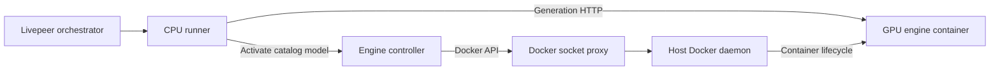

# Separate engine containers and model switching

**Status: implementation and three default GPU models validated.** The deployment supports dedicated or shared Docker hosts with a reserved GPU per managed instance. The everyday production/development stacks select managed mode; the standalone runner CLI still defaults to bundled. Separate CPU runner, external-engine, and controller-managed deployments are implemented; see [deployment instructions](../guides/container-deployment.md) and the [RTX 5090 report](../validation/reports/gpu-validation-2026-10-15.md).

Phases 1 and 2 have passed CPU delivery, switching and isolation checks. Recovery tests cover recorded ownership, interrupted operations, rollback and durable-state errors. The [hardware workload report](../validation/reports/operations-validation-2026-10-15.md) adds 832×480 rendering, 121-frame clips and 12 selected recovery cases. Phase 4 supplies all three engines, pinned asset preparation and external volumes. The supported node architecture is [`livepeer/node` orchestrator + signer + Python SDK](../guides/node-deployment.md). The [legacy paid compatibility trial](../validation/reports/paid-validation-2026-10-15.md) is historical; [replacement-node paid SSE](../validation/reports/node-paid-validation-2026-10-16.md) now passes for all three defaults. Paid persistent delivery remains a gate, alongside daemon/host outages, active-job runner crashes, larger models, public HTTPS, long-duration operation, settlement and measured GPU rollback deadlines. Test deployments/artifacts have been removed; preserved model volumes can be reused.

The implemented managed deployment uses a small CPU adapter image and separate GPU engine containers. A dedicated controller provides dynamic model switching through a Docker socket proxy. The runner receives neither raw nor proxied Docker API access.

The phased sections below retain the original rollout goals. They are design history, not a claim that every exit check has passed. Use the current [validation matrix](../validation/index.md) for evidence and the deployment guide for executable commands.

## Architecture and ownership

| Component         | Responsibility                                                                                                            |
| ----------------- | ------------------------------------------------------------------------------------------------------------------------- |
| Runner            | Livepeer registration, admission, sessions, billing integration, engine HTTP adapters, and delivery over SSE and trickle. |
| Engine controller | Model activation, container ownership, GPU assignment, readiness, lifecycle diagnostics, rollback, and recovery.          |
| Socket proxy      | Restrict Docker API operations reachable by the controller. Only this component mounts the daemon socket.                 |
| Engine            | CUDA, PyTorch, model loading, and the generation API.                                                                     |
| Compose           | Deploy the runner, controller, proxy, and their networks. In managed mode, the controller owns engine containers.         |

The runner, controller, and engine share a generation network so the controller can check engine readiness. The runner and controller also share a private control network; bind the controller API to its control interface and authenticate callers. Only the controller and proxy join the Docker API network; neither the runner nor the engine can reach the proxy. Publish no controller, proxy, or engine ports on the host. Engine HTTP must bind to its container network interface rather than loopback.

External mode takes a configurable engine URL; managed mode obtains the active endpoint from the controller. Engine HTTP clients and lifecycle supervision are separate. Lifecycle code stays free of Livepeer dependencies: the runner coordinates deregistration and job draining, while the controller manages Docker resources.

## Benefits and costs

The CPU runner can be built and released independently of engine images. A common runner can use pinned SGLang, vLLM-Omni, and LightX2V deployments through the existing HTTP adapters. GPU access and weights mounts move entirely to the engine containers.

The GPU host still needs engine images and weights. Docker already reuses inherited image layers, so separation does not eliminate their storage cost. A smaller engine image is a separate optimization. Generation performance and model load times still depend on the engine and hardware.

The additional cost is lifecycle coordination: the controller must handle readiness, interrupted switches, ownership, and recovery. Model switches still cause downtime on the assigned GPU. The controller and proxy remain trusted components with significant authority over the shared Docker daemon.

## What the socket proxy protects

[Tecnativa/docker-socket-proxy](https://github.com/Tecnativa/docker-socket-proxy) is useful as an additional restriction. Its stock rules control API path groups and methods. They do not enforce our model catalog or container ownership.

The [ACL configuration at commit 2e118a0](https://github.com/Tecnativa/docker-socket-proxy/blob/2e118a0c0c66e1831f68b7afd6d49ad3e2f96b5d/haproxy.cfg) has these consequences:

- `POST=1` opens the global gate for non-read methods; enabled path groups then determine access.
- `CONTAINERS=1` covers the broad `/containers` prefix, including container creation. It does not restrict image choices, mounts, or privileges in request bodies.
- `ALLOW_START` and `ALLOW_STOP` narrow lifecycle paths, but do not limit the target container ID to our engines. They also require the global method gate.
- The stock ACLs do not enforce an ownership label, model allowlist, or permitted GPU.

Therefore the proxy cannot replace the controller's resource and configuration policy. Enabling container creation is not a sufficient security boundary for an untrusted caller. Even a client limited to starting and stopping containers could disrupt unrelated workloads without an ownership policy.

The project's [deployment guidance](https://github.com/Tecnativa/docker-socket-proxy/blob/2e118a0c0c66e1831f68b7afd6d49ad3e2f96b5d/README.md#security-recommendations) requires network isolation and notes that the proxy does not provide TLS. Keep the proxy reachable only by the controller. The implementation pins its tested proxy image by digest in `compose.prod.yml` and `compose.dev.yml` and mounts a narrower exact-route policy; the source commit above explains why the stock flags alone are insufficient. A read-only bind mount of the Unix socket does not make Docker API requests read-only.

## Phased rollout

### Phase 1 Separate the runner and engine

Start with an externally managed SGLang container and one configured model. Compose owns that engine during this phase; the runner has no Docker permissions.

- Add an explicit external-engine lifecycle mode and configurable engine URL. Existing bundled mode remains the migration fallback.
- Build a CPU runner without CUDA, PyTorch, or engine packages. Review the current dependency split so stub-only packages can stay with the stub.
- Treat backend readiness separately from process liveness. Verify the served model through engine metadata where available; otherwise validate the pinned launch configuration and generation output during deployment testing.
- Refuse work and withdraw availability when the engine is unavailable. Reconnect after recovery. Disable model switching in external mode with a clear error.
- Exercise the same deployment shape with a CPU stub before using the 5090.

**Exit checks:** discovery, single-shot, persistent sessions, cancellation, and engine restart work through a separate container; no premature registration occurs during loading; the runner has no GPU or Docker access. Measure runner image size and run an actual FastWan generation on the 5090. A successful import or an `sm_120` build flag is not a generation result.

### Phase 2 Add controlled dynamic switching

Introduce the controller and socket proxy together. There is no intermediate phase that gives the runner Docker access on the shared host. Initial development and failure injection use disposable containers or a recording Docker API substitute.

- Give the controller a trusted, read-only engine catalog containing pinned image digests, argument vectors, approved host mounts, network settings, and the assigned GPU UUID. Keep this deployment configuration separate from public model metadata.
- Accept catalog model IDs and operation identifiers from the runner. The caller cannot supply images, commands, host paths, Docker resource IDs, or raw Docker request bodies.
- Validate every inspected or mutated resource against controller-owned state and its expected configuration. Labels identify candidates; labels alone are not authorization.
- Create replacement containers from catalog configuration, reusing a persistent weights cache. Stop the old engine before starting its replacement on the same GPU. Leave unrelated containers, networks, images, and volumes untouched.
- Restrict proxy access to the operations required by the tested controller. Pre-provision the engine networks and weights directories so broad network, volume, image-management, and build APIs are unnecessary.
- Serialize activation per GPU and reject conflicting switches. Retried requests with the same operation identifier reuse the same operation; conflicting payloads are rejected.
- Return an operation handle internally and poll its status so long model loads do not depend on one long-lived controller HTTP request. Preserve the existing operator model-switch response semantics.

The runner drains work and deregisters before requesting activation. The controller waits for the old container to exit, starts the replacement, and checks engine readiness. The runner registers only after the requested model is ready. On failure, stop the replacement and restore the previous known-good configuration; if rollback fails, remain unavailable and report both failures.

**Exit checks:** switching between two SGLang catalog models works in both delivery modes; conflicting switches are rejected; rollback works; unrelated test containers remain unaffected; the runner and engine cannot reach the Docker API network. Test the selected proxy image against the host's Docker API version and socket location.

### Phase 3 Validate recovery and deployment policy

Persist the desired model, active configuration, last known-good configuration, operation identifier, and transition state before making Docker changes. On restart, reconcile that state with owned containers. A running or HTTP-healthy engine is not necessarily idle: clear orphaned jobs or recreate the engine before readmitting work when job state cannot be established.

- Test crashes after stopping the old engine, after creating its replacement, during model loading, and before Livepeer registration.
- Test duplicate requests, controller restart, runner restart, daemon restart, lost HTTP connections, missing weights, failed cancellation, and rollback failure. Do not automatically resubmit a generation whose outcome is unknown.
- Prove that arbitrary images, extra mounts, privileged settings, unassigned GPUs, foreign container IDs, and unsupported operations are rejected before reaching Docker. Use a fake daemon to test dangerous request shapes.
- Test proxy denials against a recording upstream. Broad API-group settings must not be described as per-container authorization.
- Authenticate controller callers, keep its configuration unwritable by the runner, and record switch decisions without logging tokens or unnecessary prompt content.
- Verify exclusive ownership of the assigned GPU slot. A second controller must not operate that slot concurrently.
- Validate the actual rootful or rootless daemon, NVIDIA runtime, socket permissions, and host bind paths. Host paths are resolved by the daemon, not relative to the runner container. Do not copy privileged deployment settings from examples without establishing a host-specific need.
- Record load time, switch duration, rollback time, failures, and peak GPU memory. Select proxy timeouts and controller deadlines from these results.

**Exit checks:** failure injection leaves at most one managed engine active per GPU; registration matches the recovered model; unavailable or ambiguous state fails closed; controller/proxy interruptions leave unrelated workloads unaffected. Passing this phase is required before enabling managed switching for network operation on the shared host.

The proxy limits exposed operations, but a compromised controller may still misuse permitted Docker calls. Its catalog policy protects against untrusted callers, not arbitrary code execution inside the controller. If that residual authority is unacceptable, use a separate daemon under a distinct account or a dedicated GPU host, or evaluate daemon-side authorization.

### Phase 4 Extend engine coverage

The implementation includes pinned vLLM-Omni and SGLang images, a thin LightX2V engine image with pinned source/configuration, and matching managed catalogs and a shared configurable external recipe. The combined `all` catalog prefixes model IDs with engine names and switches engines on the same GPU. External mode launches its selected model from the same public catalog as the runner. CPU fixtures exercise each catalog through the Livepeer path, and contract tests compare launch commands and API request fields.

Unknown job outcomes force a reset before readmission in bundled/managed modes; external mode requires operator recovery. The default models pass real GPU startup, rendering and selected disconnect/cancellation/crash exercises. Larger model resource limits and independent served-model metadata checks still need hardware validation. Passing CPU fixtures does not establish those hardware properties.

Keep one runner paired with one active engine on its assigned GPU. Add multiple GPU slots only after ownership and recovery work for one slot. Pooling several runners behind one engine would require shared admission control and is outside this rollout.

## Switching and catalog rules

For managed mode, restarting the same container preserves its startup configuration. Selecting another catalog model normally means creating a replacement with different arguments. Pre-created containers are an optional later optimization; they do not remove model loading time or the need to authorize each target.

The existing Livepeer app IDs, job payloads, SSE events, and trickle delivery remain the contract to preserve. New lifecycle flags and catalog fields are versioned configuration changes under the repository's [versioning policy](../../CONTRIBUTING.md#versioning). Bundled and external modes remain supported. The focused cleanup selected managed mode for the everyday Compose stacks without changing the runner CLI default or approving any mode retirement.

Images and weights should be staged before activation so a switch is a bounded load operation. Pin exact image digests, retain the previous known-good specification, and never prune the shared host's Docker cache as part of switching. The controller should request only the assigned GPU and the fixed mounts it needs.

## Initial choices and remaining decisions

| Decision                 | Proposed starting point                                                                                                                         | Why it matters                                                                                                     |
| ------------------------ | ----------------------------------------------------------------------------------------------------------------------------------------------- | ------------------------------------------------------------------------------------------------------------------ |
| Shutdown ownership       | Stop the managed engine on graceful runner shutdown. On a crash, reconcile and clear unknown work before serving.                               | Matches current lifecycle behavior; keeping models warm across runner restarts needs reliable orphan-job handling. |
| Model preparation        | Pre-pull images and stage weights through operator tooling. Fail activation clearly when assets are missing.                                    | Avoids unpredictable downloads while the GPU is unavailable.                                                       |
| Drain and load deadlines | Current drain waits without a deadline; loads use catalog timeouts. Select drain and rollback limits from measured workloads.                   | Controls downtime and protects active paid work. A force-cancel operation can be designed separately.              |
| Controller transport     | Private authenticated HTTP for model operations; proxy HTTP on a separate controller-only network.                                              | Establishes caller identity without exposing Docker API access to the runner.                                      |
| Daemon isolation         | Use the existing daemon only with the controller policy and phase 3 validation. Revisit a separate daemon if controller compromise is in scope. | GPU exclusivity does not isolate a shared Docker daemon.                                                           |
| Migration                | Everyday Compose selects managed mode; keep bundled/external recipes available. Retirement needs separate approval.                             | Allows operators to roll back without changing Livepeer client behavior.                                           |

Managed deployment reserves one GPU per instance; a shared Docker host requires the ownership and isolation rules above. External volumes preserve model downloads and controller state across stack removal. A state-directory lock excludes duplicate controllers using the same state, and a shared GPU lease volume excludes managed deployments targeting the same GPU UUID. All controllers must use the same lease volume; unrelated GPU applications are not covered. Engine log collection remains a host-operator action, keeping the proxy's API surface smaller. The remaining choices can be refined from hardware measurements without changing the Livepeer job contract.
